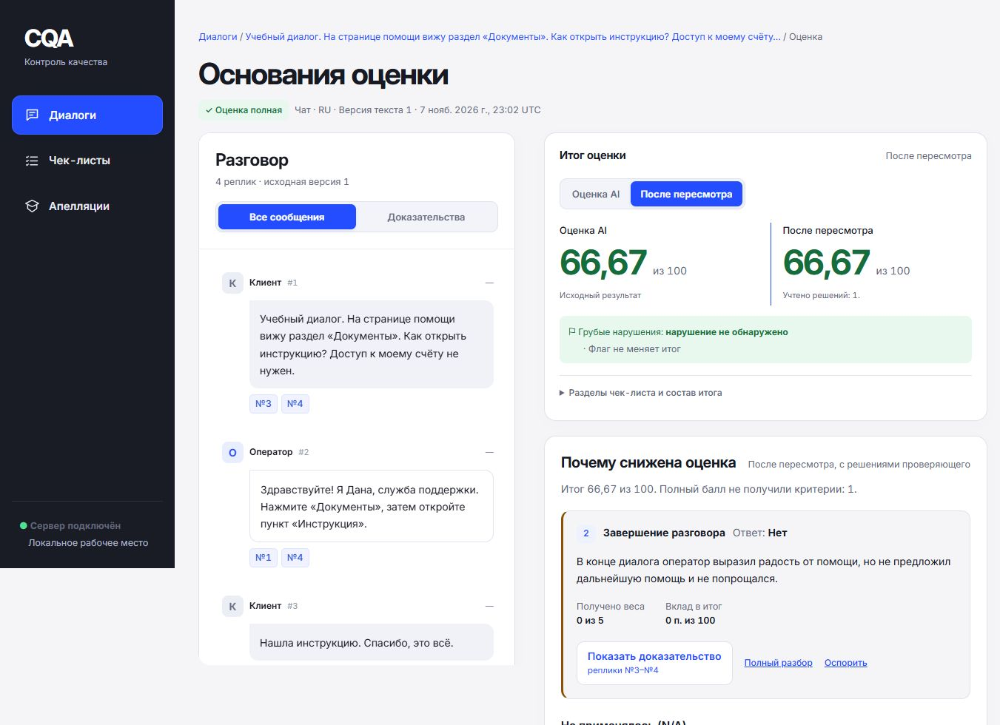
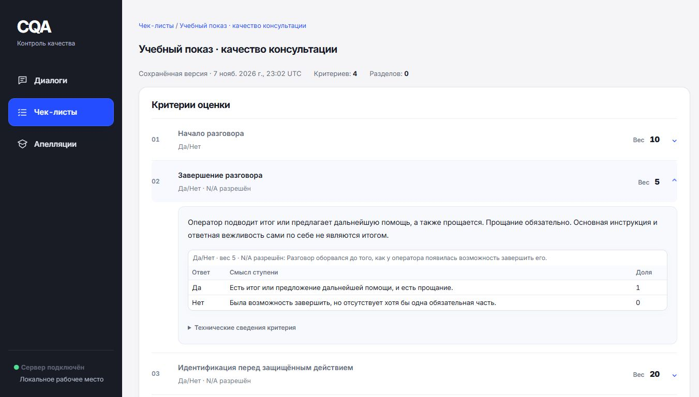
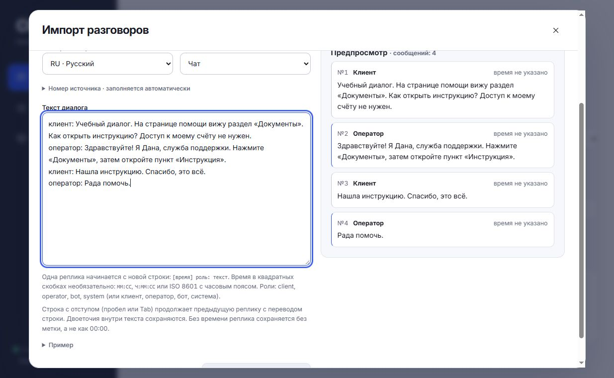
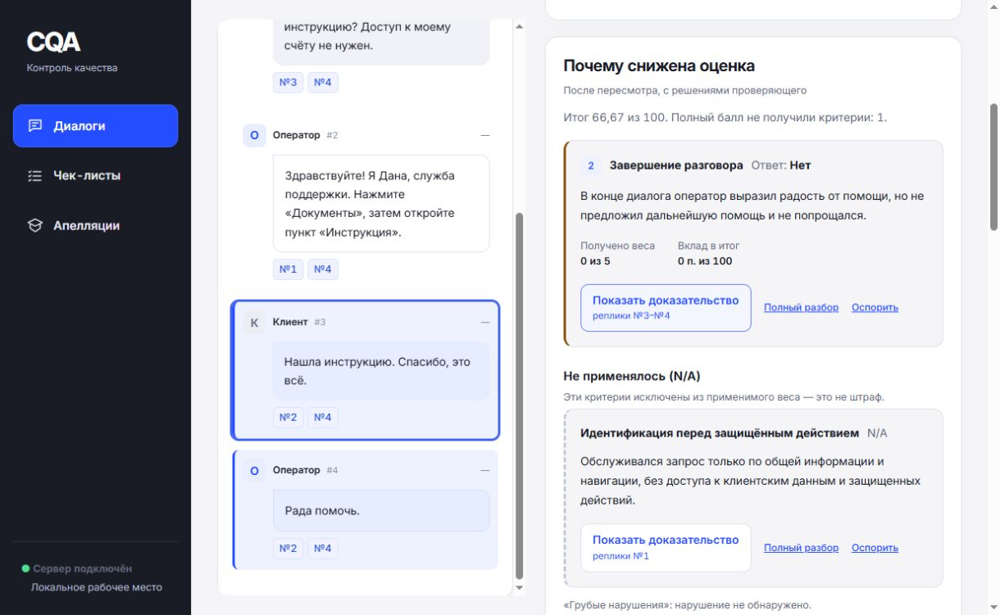
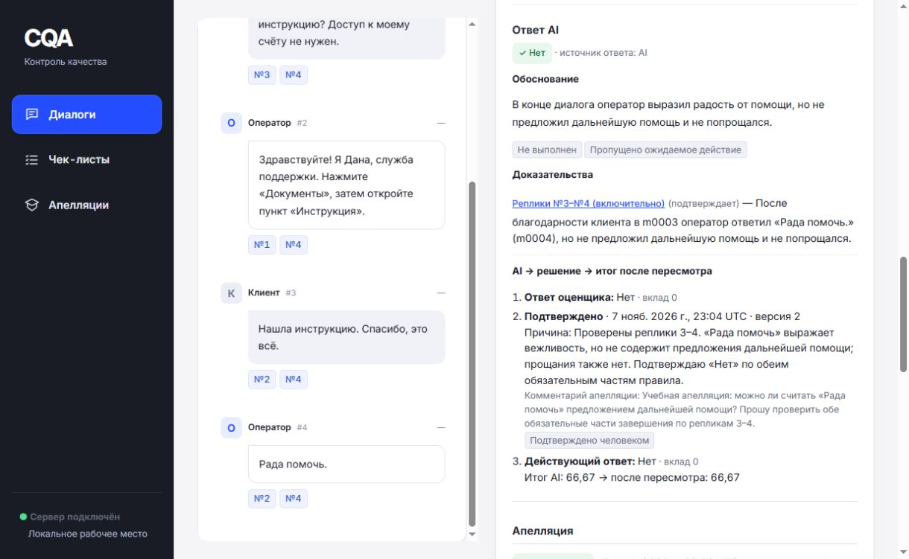
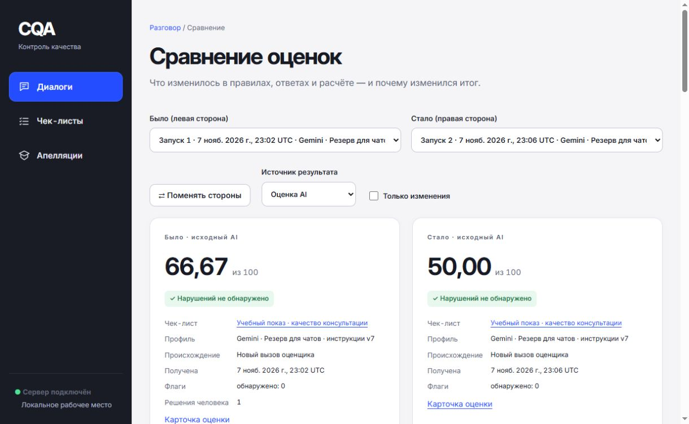
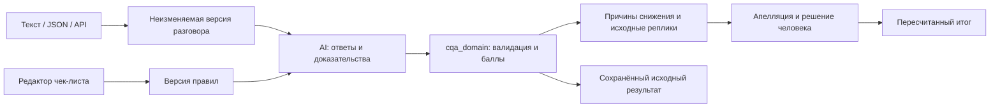

# CQA — каждая оценка с доказательством

От изменяемого чек-листа до мотивированного решения проверяющего: CQA оценивает
разговор, объясняет потерю баллов и открывает исходные реплики в один клик.



*Настоящий production-интерфейс на выдуманном диалоге. Сохранённая оценка
Gemini/v7 (`gemini-3.5-flash-lite`), затем подтверждение человеком. Число 66,67 —
доменный расчёт по учебному чек-листу, не показатель точности AI.*

[Защита до пяти минут](docs/DEFENSE_5_MIN.md) ·
[Контрольные 10 чатов](docs/CONTROL_RUN.md) ·
[Требования и доказательства готовности](docs/NIGHT_READINESS.md)

## Полный цикл в шесть шагов

| 1. Настроить правила | 2. Получить разговор |
|---|---|
| Формулировки, варианты, вес и N/A задаются в редакторе. Сохранение создаёт новую версию. | Вставка текста, JSON или API организаторов. Предпросмотр проверяет роли и время до импорта. |
| [](docs/assets/defense-20261108/01-rules.jpg) | [](docs/assets/defense-20261108/02-import.jpg) |
| **3. Оценить выбранным профилем** | **4. Проверить доказательства** |
| Итог, причины снижения, N/A и нарушения видны раздельно. Сохранены модель, вызовы, токены и происхождение. | Из причины снижения — прямо к выделенным репликам. Неопределённость не маскируется полным итогом. |
| [](docs/assets/defense-20261108/03-evaluation.jpg) | [](docs/assets/defense-20261108/04-evidence.jpg) |
| **5. Рассмотреть апелляцию** | **6. Сравнить после изменения правил** |
| Проверяющий подтверждает или меняет ответ с обоснованием. Исходная AI-оценка остаётся доступной. | Видно, что изменилось: критерий, смысл ответа, вес, применимость, флаг и вклад в итог. |
| [](docs/assets/defense-20261108/05-appeal.jpg) | [](docs/assets/defense-20261108/06-compare.jpg) |

Все шесть снимков показывают один выдуманный разговор. Две настоящие оценки
Gemini дали 66,67 и 50,00 после замены критерия и изменения веса. Это проверка
рабочего цикла, **не сравнение качества моделей**. Отдельный встроенный
«Посмотреть пример» — ручной учебный разбор без AI-вызова, расходов и записи в БД.

## Как устроено доверие



AI выбирает ответы по переданным правилам; **арифметику считает domain**.
N/A исключается из применимого веса. Грубое нарушение — отдельный флаг без
штрафа. Отсутствие доказуемого ответа сохраняет неполноту, а не подставляет
удобное «Нет». Решения человека и расходы повторов хранятся отдельно от
неизменяемого исходного артефакта. Изменение весов допускает совместимый
пересчёт без нового вызова; изменение смысла критерия требует новой оценки.

## Модели, качество и доступность

| Назначение | Закреплённый профиль | Что подтверждено |
|---|---|---|
| Контрольные **чаты** | `boundary-xerosharc-v7-1` / 1, prompt v7 | На направленной разметке агента: 99/123 против 90/123 у v4; полнота 59/60 против 58/60. Это диагностика разработки, не независимая точность. |
| Общий default и звонки | `live-xerosharc-quality-v1` / 1, prompt v4 | На выбранных пунктах звонков v7 ухудшился: 17/18 → 12/18. Поэтому для звонков v7 не выбран. Разметка та же, не независимая. |
| Ручной резерв | `boundary-gemini-v7-1` / 1, prompt v7 | Две полные оценки нового выдуманного диалога с заменой критерия: 2 вызова, 10 915 токенов, задания 3,6 и 8,6 с. Это проверка доступа и интеграции. |
| Опубликованный DEV | `live-gemini-35-flash-lite-v1` / 1, prompt v2 | Исторический экспорт 65/65, собранный из сохранённых запусков и повторов. Provenance проверена; файл не заменён экспериментами. |

**Xerosharc возвращает `xeros_core`; внутренняя модель не подтверждена**, хотя
запрашивается `gpt-6.1-sol`. Ночная проверка 8 ноября: короткий запрос успешен,
полный запрос отклонён по квоте (`pre_consume_token_quota_failed`). Перед контролем
нужна рабочая квота либо явное переключение на резерв по
[инструкции](docs/CONTROL_RUN.md). Автоматического fallback нет. Цена вызовов
не подтверждена: в интерфейсе показано **«неизвестна»**, не ноль.

Все известные семейства DEV участвовали в разработке; чистого holdout и
официального Ground Truth нет. Новый эксперимент не дал смысловых результатов
из-за квоты и не заменил принятый v7.
[Разбор чатовых ошибок](docs/CONTROL_CHAT_PROFILE.md) ·
[История сравнений](docs/AI_BOUNDARIES.md) ·
[Официальный DEV](results/dev/results.json).

Репетиция десяти выдуманных чатов заняла 8 минут 2 секунды от импорта до
проверенного push, без предварительной подготовки. Это измерение процесса,
не обещание скорости нового набора или доступности провайдера.

## Запуск локального приложения

Нужны установленные зависимости, локальный профиль и ключ провайдера. Время
чистой установки не измерялось. После настройки:

```sh
npm run build
uv run uvicorn cqa_api.main:app --host 127.0.0.1 --port 8000 --workers 1
```

Откройте [приложение](http://127.0.0.1:8000). В диалоге запуска явно выберите
профиль. Без ключа оценка недоступна; тестовая заглушка сама не включается.
[Конфигурация Xerosharc](examples/xerosharc-config/README.md),
[основной и резервный профили чатов](examples/control-config/README.md).
Данные сохраняются в SQLite на локальном диске, Docker не требуется.

## Карта проекта

| Путь | Назначение |
|---|---|
| `apps/web` | React-интерфейс, редактор, объяснение, доказательства и пересмотр |
| `apps/api` | FastAPI, импорт, очередь, апелляции, журнал расходов, SQLite |
| `packages/cqa_domain` | Правила, Decimal-арифметика, применимость, неизменяемые версии |
| `packages/cqa_ai` | Провайдеры, промпты, проверка ответа, repair и лимиты |
| `packages/cqa_contracts` | Единые DTO и генерация OpenAPI / TypeScript |
| `packages/cqa_submission` | Официальный экспорт и проверка происхождения |
| `results/dev` | Опубликованный DEV; настоящий PROD появится после получения контроля |

RU/KZ/EN, чаты и расшифровки звонков поддерживаются. Анализ звука и точность
распознавания речи не заявляются. HTTP API 1.4.0; официальный JSON 1.0 отделён
от продуктового SafeExport. [Подготовка сдачи](docs/SUBMISSION.md).


## Среда и чистая установка

Python **3.13.5**, uv **0.13.7**, Node **26.1.0**, npm **11.13.0**.
Версии закреплены в manifests, `uv.lock`, `package-lock.json`, `.python-version`
и `.node-version`. Docker не требуется. Приложение рассчитано на один локальный
экземпляр с SQLite WAL на постоянном локальном диске. Миграции выполняются при
старте; исходный чек-лист создаётся при первом запуске пустой БД.

Из корня репозитория после установки указанных Python и Node:

```sh
python -m pip install uv==0.13.7
npm install --global npm@11.13.0
uv sync --locked --all-packages --dev
npm ci
npx playwright install chromium
```

На Linux для браузерного smoke вместо последней команды:
`npx playwright install --with-deps chromium`.
В PowerShell при запрете запуска `npm.ps1` используйте `npm.cmd` и `npx.cmd`.
Если uv установлен в текущей среде вне PATH, используйте `python -m uv`.
Локальная техническая установка интегратора `.tools/bin/uv.exe` игнорируется Git
и не является обязательной частью проекта.

## Запуск API и собранного интерфейса

Из корня репозитория:

```sh
npm run build
uv run uvicorn cqa_api.main:app --host 127.0.0.1 --port 8000 --workers 1
```

Открыть [локальный интерфейс](http://127.0.0.1:8000) и
[OpenAPI](http://127.0.0.1:8000/docs).
Сервер отдаёт `apps/web/dist` и API под `/api/v1`; состояние доступно через
`GET /api/v1/health`. Без локального production-профиля и ключа реальная оценка
недоступна. Проверка health сама по себе не подтверждает доступность провайдера,
квоты или качество оценок.

Разработка web в отдельном терминале: `npm run dev`.
Vite обслуживает [локальный dev-интерфейс](http://127.0.0.1:5173), API остаётся
на порту 8000.

По умолчанию `CQA_WORKER_ENABLED=true`: управляемый исполнитель заданий работает
внутри единственного процесса API. `CQA_WORKER_CONCURRENCY=2` ограничивает число
одновременных заданий этого исполнителя. Для отдельного worker запустите API с
`CQA_WORKER_ENABLED=false`, затем в другом терминале с той же конфигурацией:
`uv run python -m cqa_api.worker`. На одну БД должен приходиться один управляемый
исполнитель; не запускайте одновременно встроенный и отдельный worker.

`CQA_DEADLINE_GRACE_SECONDS=10` даёт оценщику до десяти секунд после общего
`deadline_at` для завершения уже полученного результата и обязательной записи
событий. Этот интервал не разрешает новые вызовы провайдера и не сбрасывает
бюджет. Если оценщик не завершился, worker отменяет попытку.

## Явный тестовый режим

Для локальной проверки пользовательского цикла без AI-сети и ключей задайте оба
режима как `test` и отдельные пути данных. PowerShell:

```powershell
$env:CQA_MODE = "test"
$env:CQA_EVALUATOR = "test"
$env:CQA_TEST_SCENARIO = "complete"
$env:CQA_DATA_DIR = "data/private/local-test"
$env:CQA_DATABASE_URL = "sqlite:///data/private/local-test/cqa.sqlite3"
uv run uvicorn cqa_api.main:app --host 127.0.0.1 --port 8000 --workers 1
```

Bash:

```bash
CQA_MODE=test CQA_EVALUATOR=test CQA_TEST_SCENARIO=complete \
  CQA_DATA_DIR=data/private/local-test \
  CQA_DATABASE_URL=sqlite:///data/private/local-test/cqa.sqlite3 \
  uv run uvicorn cqa_api.main:app --host 127.0.0.1 --port 8000 --workers 1
```

Открывайте предварительно собранный интерфейс или запускайте `npm run dev`.
В интерфейсе импортируйте синтетический JSON, выберите чек-лист и профиль
`test-synthetic`, запустите пакет и откройте оценку. Сценарии `partial` и `failed`
выбираются через `CQA_TEST_SCENARIO` при отдельном запуске. Результаты тестового
оценщика имеют `evaluator_mode=test` и `origin=test`; это проверка функций, а не
содержательная оценка разговора. Импорт организаторов и загрузка аудио являются
отдельными сетевыми действиями — для offline-проверки используйте синтетический JSON.

## Production-профили и приватная конфигурация

Значения по умолчанию — `CQA_MODE=production` и `CQA_EVALUATOR=production`.
Оба значения должны совпадать; несогласованная конфигурация останавливает запуск.
Окружение имеет приоритет над локальным `.env`, поэтому после тестового запуска
измените обе переменные или откройте новый терминал.

Скопируйте `.env.example` в игнорируемый `.env` и настройте локальную БД/каталог
данных. Ключи задавайте только окружением или этим приватным файлом. Затем:

1. Поместите валидные неизменяемые `CorpusSnapshot` в
   `<CQA_CONFIG_DIR>/corpora/*.json`, а `EvaluatorProfile` — в
   `<CQA_CONFIG_DIR>/profiles/*.json`. По умолчанию `CQA_CONFIG_DIR` равен
   `<CQA_DATA_DIR>/config`. Снимки и их hash создаются средствами домена/AI;
   не подставляйте фиктивные hash из старых примеров.
2. В профиле укажите `mode=production`, конкретные provider/model, версию профиля,
   закреплённый `prompt_version` (для принятых профилей v2/v4/v7), `preprocessing_version=identity-v1`, существующий
   `corpus_snapshot_id` и конечные лимиты вызовов, повторов и времени. Ключей в JSON
   профиля быть не должно. Для изменения зарегистрированного профиля нужна новая
   версия; изменение содержимого прежней версии отклоняется.
3. Задайте ключи всех включённых провайдеров, в том числе reviewer/fallback:
   `GEMINI_API_KEY`, `DEEPSEEK_API_KEY`, `OPENROUTER_API_KEY` по составу профиля.
   Перезапустите сервер и проверьте `GET /api/v1/evaluator-profiles`: поле
   `configured` и безопасная `configuration_error` отражают проверку конфигурации.

Отсутствие ключа или недопустимый профиль дают явную ошибку; переключения на
тестовые ответы нет. Подтверждение конфигурации не выполняет живой запрос.
Доступность выбранной модели, квоты и фактическая стоимость проверяются отдельно
перед реальным прогоном. В текущем production entrypoint таблица тарифов пуста:
неизвестная стоимость остаётся `null`, а ограничение стоимости без подтверждённого
тарифа не разрешает вызов. Подробности — в [AI README](packages/cqa_ai/README.md).

## Контракты и проверки

Единственный источник публичных моделей — `packages/cqa_contracts/src`.
HTTP operation contract находится в том же пакете. JSON Schema/OpenAPI/TypeScript
в `contracts/` генерируются; не редактируйте их вручную.
Десятичные значения передаются строками, `null` остаётся `null`.
Безопасный экспорт использует отдельные DTO без транскрипта, свободных пояснений
и URL. Контрактные fixtures в `fixtures/contracts/` полностью синтетические.

| Действие | Команда из корня |
|---|---|
| Обновить generated-контракты | `uv run python scripts/generate_contracts.py` |
| Проверить отсутствие drift | `uv run python scripts/generate_contracts.py --check` |
| Python lint | `uv run ruff check .` |
| Python typecheck | `uv run mypy` |
| Python, fixtures, домен/AI и API | `uv run pytest` |
| TypeScript | `npm run typecheck` |
| Web unit tests | `npm test` |
| Production web build | `npm run build` |
| Браузерные сценарии на API | `npm run e2e` |
| Общая автоматическая проверка | `uv run python scripts/check.py` |

Перед отдельным `npm run e2e` выполните `npm run build`. Playwright запускает
настоящий API с явными тестовыми сценариями complete/partial/failed и отдельными
БД под `data/private/c-e2e/`; успешные HTTP-ответы не подменяются браузерными mocks.
Общая команда останавливается на первом неуспешном шаге. CI настроен на Windows и
Linux; фактический результат конкретного SHA смотрите в его запуске CI/handoff.

Эти проверки не выполняют живые запросы AI и не доказывают точность на закрытом
Ground Truth. Матрица E01–E20, исключения и ограничения браузерных сценариев
описаны в [handoff C](docs/handoffs/claude-web-e2e.md). Реальный provider smoke,
квоты, качество RU/KZ/EN и работа с приватными данными требуют отдельной приёмки.

## Владение и интеграция

| Владелец | Ветка | Пути |
|---|---|---|
| Claude A | `claude/domain-ai` | `packages/cqa_domain`, `packages/cqa_ai`, `fixtures/evaluation`, свой handoff |
| Claude B | `claude/api-jobs` | `apps/api`, свой handoff |
| Claude C | `claude/web-e2e` | `apps/web`, свой handoff |
| Интегратор | `integration/gpt-pro` | общие контракты/fixtures, scripts, manifests/lockfiles, CI, общая документация |

Все четыре ветки получили общий опубликованный foundation SHA, указанный
в отчёте поставки. Текущая интеграционная ветка содержит последующие поставки.
Использовать отдельные клоны/worktrees и отдельные `.env`/БД.
Сначала проверить `git rev-parse HEAD`. Не переключать общую рабочую директорию
между агентами. Изменение shared-контрактов/зависимостей направлять интегратору;
продолжающиеся ветки интегрируются merge-коммитами с сохранением истории.

## Оставшиеся ограничения

Живые вызовы провайдеров, реальные данные организаторов, подтверждённые тарифы и
независимая точность не проверяются обычным тестовым набором. Аудиоплеер не означает
акустического анализа: текущий оценщик работает по тексту. Подробные ограничения
поставок сохраняются в handoff A/B/C и отчёте интегратора.

Новый фильтр грубых ошибок определён в
[дополнении организаторов](docs/specs/05_ORGANIZER_ADDENDUM.md) и
[контракте фильтра](docs/FLAG_FILTER_CONTRACT.md). На экране «Диалоги» выберите
чек-лист, точную версию, флаговый критерий и состояние. Automatic показывает исходный
ответ оценщика, effective — результат с решениями проверяющего. «Неизвестно» не
равно отсутствию нарушения; из строки можно открыть объяснение и доказательства.
Точный поиск поддерживает один выбранный флаг. Быстрый отбор «Есть нарушения»
показывает разговоры, у которых хотя бы один флаг выбранной оценки обнаружен.

## Приватные данные

`CQA_DATASET_URL` и ключи
`GEMINI_API_KEY`, `DEEPSEEK_API_KEY`, `OPENROUTER_API_KEY`, `XEROSHARC_API_KEY` остаются пустыми в Git.
Секретный адрес организаторов используется только сервером; браузер передаёт
`group_id`, а не URL. Исходные подписанные audio URL наружу не выдаются; допустимые
хосты задаются через `CQA_AUDIO_ALLOWED_HOSTS`.

Реальные разговоры, аудио, БД, результаты запусков, signed URLs, скриншоты и
traces с личными данными хранить в игнорируемом `data/private/`.
Не публиковать приватные материалы под видом fixtures. Каждый исполнитель
проверяет diff перед публикацией; `.gitignore` не заменяет эту проверку.
БД использует WAL: для резервной копии остановите сервер либо примените SQLite
backup API/`.backup`; копии одного основного файла работающей БД недостаточно.

## Технические материалы

- [Требования и архитектура](docs/specs/00_MASTER_SPEC.md), [уточнения организаторов](docs/specs/05_ORGANIZER_ADDENDUM.md).
- [API и хранение](apps/api/README.md), [оценщик и ограничения](packages/cqa_ai/README.md), [интерфейс и сценарии](docs/handoffs/claude-web-e2e.md).
- [Подготовка сдачи](docs/SUBMISSION.md), [отчёт интеграции](docs/handoffs/gpt-pro.md).
