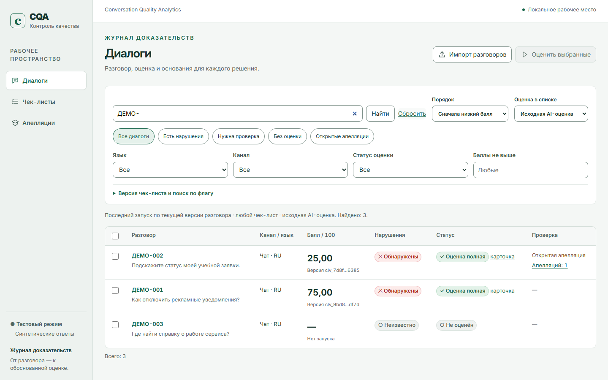

# CQA — Conversation Quality Analytics

CQA помогает руководителю качества находить рискованные разговоры, понимать
основания AI-оценки и пересматривать решения по изменяемому чек-листу.
Работает локально: браузер, Python API и постоянная SQLite-база, без Docker.



*Пример интерфейса на выдуманных разговорах с явно включённым тестовым оценщиком.
Показанные баллы иллюстрируют процесс, а не точность модели на реальных клиентах.*

- **От оценки к доказательству.** Каждый вывод связан с исходными репликами.
  Баллы, нарушения, причины проверки и открытые апелляции видны в списке;
  поиск и сортировка работают по всему набору, а не только по открытой странице.
- **Правила можно менять.** Редактор создаёт новую версию чек-листа. Сравнение
  двух оценок показывает прежний и новый итог, ответы, основания и изменения правил.
  При смене только весов совместимый результат можно пересчитать без нового AI-вызова.
- **Человек может пересмотреть решение.** Апелляция и решение сохраняются отдельно.
  Исходная AI-оценка остаётся доступной; расходы учитывают все попытки задания.

## Быстрый запуск с Xerosharc

После [установки зависимостей](#среда-и-чистая-установка) скопируйте
`examples/xerosharc-config/profiles/live-xerosharc-quality-v1.json` в
`data/private/config/profiles/`, а `examples/xerosharc-config/corpora/` — в
`data/private/config/corpora/`. В локальном `.env` задайте:

```dotenv
XEROSHARC_API_KEY=<ваш ключ>
XEROSHARC_BASE_URL=https://xerosharc.site/v1
CQA_DEFAULT_EVALUATOR_PROFILE=live-xerosharc-quality-v1
```

```sh
npm run build
uv run uvicorn cqa_api.main:app --host 127.0.0.1 --port 8000 --workers 1
```

Откройте [приложение](http://127.0.0.1:8000), импортируйте разговоры и нажмите
«Оценить выбранные». Диалог запуска показывает выбранный профиль до отправки.
Профиль использует `cqa-eval-v4`: применимость → условия критерия → доказательство →
согласованность вывода. Предыдущие профили и их инструкции сохраняются.
[Настройки и ограничения шлюза](examples/xerosharc-config/README.md).

## Что показать за пять минут

Найдите нарушение быстрым фильтром → откройте доказательство → рассмотрите
апелляцию → измените правило или вес → запустите новую оценку → сравните результаты.
Для незнакомого разговора используйте «Новый анализ», чтобы результат действительно
прошёл выбранного провайдера. У переиспользованной оценки показывается её источник.

## Результаты и границы

Официальный [DEV-файл](results/dev/results.json) содержит 65 результатов с
проверенным происхождением. Новый Xerosharc/v4 обработал те же 65 разговоров:
62 полные оценки, 3 неполные. На выбранных проблемах из аудита совпадение с разбором
правил выросло с 3/17 до 16/17, но обнаружено и новое ложное срабатывание.
Это не измерение общей точности: независимых экспертных меток нет, менялись
и провайдер, и инструкции. Кандидат сохранён отдельно; финальный DEV не заменён.
[Результаты, примеры ошибок и ограничения](docs/QUALITY_WORKFLOW.md).

Шлюз возвращает имя `xeros_core`, хотя профиль запрашивает `gpt-6.1-sol`.
Фактическая модель за шлюзом не подтверждена. Тариф Xerosharc не подтверждён:
неизвестная цена отображается явно и не заменяется нулём или тарифом другого API.
Разговоры RU/KZ/EN и тексты звонков поддержаны; акустический анализ и точность
распознавания речи не заявляются. Точные переходы по аудио доступны только при
проверенной привязке времени.

Текущий HTTP API — **1.4.0**. [CI](https://github.com/Mustiks07/Vtiposhniki/actions)
проверяет код и пользовательские сценарии отдельно от содержательного качества AI.
Официальный экспорт JSON 1.0 отличается от обычного SafeExport:
[подготовка и проверка сдачи](docs/SUBMISSION.md). Настоящий контрольный набор
публикуется только после его получения и обработки.

## Среда и чистая установка

Python **3.13.5**, uv **0.13.7**, Node **26.1.0**, npm **11.13.0**.
Версии закреплены в manifests, `uv.lock`, `package-lock.json`, `.python-version`
и `.node-version`. Docker не требуется. Приложение рассчитано на один локальный
экземпляр с SQLite WAL на постоянном локальном диске. Миграции выполняются при
старте; исходный чек-лист создаётся при первом запуске пустой БД.

Из корня репозитория после установки указанных Python и Node:

```sh
python -m pip install uv==0.13.7
npm install --global npm@11.13.0
uv sync --locked --all-packages --dev
npm ci
npx playwright install chromium
```

На Linux для браузерного smoke вместо последней команды:
`npx playwright install --with-deps chromium`.
В PowerShell при запрете запуска `npm.ps1` используйте `npm.cmd` и `npx.cmd`.
Если uv установлен в текущей среде вне PATH, используйте `python -m uv`.
Локальная техническая установка интегратора `.tools/bin/uv.exe` игнорируется Git
и не является обязательной частью проекта.

## Запуск API и собранного интерфейса

Из корня репозитория:

```sh
npm run build
uv run uvicorn cqa_api.main:app --host 127.0.0.1 --port 8000 --workers 1
```

Открыть [локальный интерфейс](http://127.0.0.1:8000) и
[OpenAPI](http://127.0.0.1:8000/docs).
Сервер отдаёт `apps/web/dist` и API под `/api/v1`; состояние доступно через
`GET /api/v1/health`. Без локального production-профиля и ключа реальная оценка
недоступна. Проверка health сама по себе не подтверждает доступность провайдера,
квоты или качество оценок.

Разработка web в отдельном терминале: `npm run dev`.
Vite обслуживает [локальный dev-интерфейс](http://127.0.0.1:5173), API остаётся
на порту 8000.

По умолчанию `CQA_WORKER_ENABLED=true`: управляемый исполнитель заданий работает
внутри единственного процесса API. `CQA_WORKER_CONCURRENCY=2` ограничивает число
одновременных заданий этого исполнителя. Для отдельного worker запустите API с
`CQA_WORKER_ENABLED=false`, затем в другом терминале с той же конфигурацией:
`uv run python -m cqa_api.worker`. На одну БД должен приходиться один управляемый
исполнитель; не запускайте одновременно встроенный и отдельный worker.

`CQA_DEADLINE_GRACE_SECONDS=10` даёт оценщику до десяти секунд после общего
`deadline_at` для завершения уже полученного результата и обязательной записи
событий. Этот интервал не разрешает новые вызовы провайдера и не сбрасывает
бюджет. Если оценщик не завершился, worker отменяет попытку.

## Явный тестовый режим

Для локальной проверки пользовательского цикла без AI-сети и ключей задайте оба
режима как `test` и отдельные пути данных. PowerShell:

```powershell
$env:CQA_MODE = "test"
$env:CQA_EVALUATOR = "test"
$env:CQA_TEST_SCENARIO = "complete"
$env:CQA_DATA_DIR = "data/private/local-test"
$env:CQA_DATABASE_URL = "sqlite:///data/private/local-test/cqa.sqlite3"
uv run uvicorn cqa_api.main:app --host 127.0.0.1 --port 8000 --workers 1
```

Bash:

```bash
CQA_MODE=test CQA_EVALUATOR=test CQA_TEST_SCENARIO=complete \
  CQA_DATA_DIR=data/private/local-test \
  CQA_DATABASE_URL=sqlite:///data/private/local-test/cqa.sqlite3 \
  uv run uvicorn cqa_api.main:app --host 127.0.0.1 --port 8000 --workers 1
```

Открывайте предварительно собранный интерфейс или запускайте `npm run dev`.
В интерфейсе импортируйте синтетический JSON, выберите чек-лист и профиль
`test-synthetic`, запустите пакет и откройте оценку. Сценарии `partial` и `failed`
выбираются через `CQA_TEST_SCENARIO` при отдельном запуске. Результаты тестового
оценщика имеют `evaluator_mode=test` и `origin=test`; это проверка функций, а не
содержательная оценка разговора. Импорт организаторов и загрузка аудио являются
отдельными сетевыми действиями — для offline-проверки используйте синтетический JSON.

## Production-профили и приватная конфигурация

Значения по умолчанию — `CQA_MODE=production` и `CQA_EVALUATOR=production`.
Оба значения должны совпадать; несогласованная конфигурация останавливает запуск.
Окружение имеет приоритет над локальным `.env`, поэтому после тестового запуска
измените обе переменные или откройте новый терминал.

Скопируйте `.env.example` в игнорируемый `.env` и настройте локальную БД/каталог
данных. Ключи задавайте только окружением или этим приватным файлом. Затем:

1. Поместите валидные неизменяемые `CorpusSnapshot` в
   `<CQA_CONFIG_DIR>/corpora/*.json`, а `EvaluatorProfile` — в
   `<CQA_CONFIG_DIR>/profiles/*.json`. По умолчанию `CQA_CONFIG_DIR` равен
   `<CQA_DATA_DIR>/config`. Снимки и их hash создаются средствами домена/AI;
   не подставляйте фиктивные hash из старых примеров.
2. В профиле укажите `mode=production`, конкретные provider/model, версию профиля,
   закреплённый `prompt_version` (v2/v3/v4), `preprocessing_version=identity-v1`, существующий
   `corpus_snapshot_id` и конечные лимиты вызовов, повторов и времени. Ключей в JSON
   профиля быть не должно. Для изменения зарегистрированного профиля нужна новая
   версия; изменение содержимого прежней версии отклоняется.
3. Задайте ключи всех включённых провайдеров, в том числе reviewer/fallback:
   `GEMINI_API_KEY`, `DEEPSEEK_API_KEY`, `OPENROUTER_API_KEY` по составу профиля.
   Перезапустите сервер и проверьте `GET /api/v1/evaluator-profiles`: поле
   `configured` и безопасная `configuration_error` отражают проверку конфигурации.

Отсутствие ключа или недопустимый профиль дают явную ошибку; переключения на
тестовые ответы нет. Подтверждение конфигурации не выполняет живой запрос.
Доступность выбранной модели, квоты и фактическая стоимость проверяются отдельно
перед реальным прогоном. В текущем production entrypoint таблица тарифов пуста:
неизвестная стоимость остаётся `null`, а ограничение стоимости без подтверждённого
тарифа не разрешает вызов. Подробности — в [AI README](packages/cqa_ai/README.md).

## Контракты и проверки

Единственный источник публичных моделей — `packages/cqa_contracts/src`.
HTTP operation contract находится в том же пакете. JSON Schema/OpenAPI/TypeScript
в `contracts/` генерируются; не редактируйте их вручную.
Десятичные значения передаются строками, `null` остаётся `null`.
Безопасный экспорт использует отдельные DTO без транскрипта, свободных пояснений
и URL. Контрактные fixtures в `fixtures/contracts/` полностью синтетические.

| Действие | Команда из корня |
|---|---|
| Обновить generated-контракты | `uv run python scripts/generate_contracts.py` |
| Проверить отсутствие drift | `uv run python scripts/generate_contracts.py --check` |
| Python lint | `uv run ruff check .` |
| Python typecheck | `uv run mypy` |
| Python, fixtures, домен/AI и API | `uv run pytest` |
| TypeScript | `npm run typecheck` |
| Web unit tests | `npm test` |
| Production web build | `npm run build` |
| Браузерные сценарии на API | `npm run e2e` |
| Общая автоматическая проверка | `uv run python scripts/check.py` |

Перед отдельным `npm run e2e` выполните `npm run build`. Playwright запускает
настоящий API с явными тестовыми сценариями complete/partial/failed и отдельными
БД под `data/private/c-e2e/`; успешные HTTP-ответы не подменяются браузерными mocks.
Общая команда останавливается на первом неуспешном шаге. CI настроен на Windows и
Linux; фактический результат конкретного SHA смотрите в его запуске CI/handoff.

Эти проверки не выполняют живые запросы AI и не доказывают точность на закрытом
Ground Truth. Матрица E01–E20, исключения и ограничения браузерных сценариев
описаны в [handoff C](docs/handoffs/claude-web-e2e.md). Реальный provider smoke,
квоты, качество RU/KZ/EN и работа с приватными данными требуют отдельной приёмки.

## Владение и интеграция

| Владелец | Ветка | Пути |
|---|---|---|
| Claude A | `claude/domain-ai` | `packages/cqa_domain`, `packages/cqa_ai`, `fixtures/evaluation`, свой handoff |
| Claude B | `claude/api-jobs` | `apps/api`, свой handoff |
| Claude C | `claude/web-e2e` | `apps/web`, свой handoff |
| Интегратор | `integration/gpt-pro` | общие контракты/fixtures, scripts, manifests/lockfiles, CI, общая документация |

Все четыре ветки получили общий опубликованный foundation SHA, указанный
в отчёте поставки. Текущая интеграционная ветка содержит последующие поставки.
Использовать отдельные клоны/worktrees и отдельные `.env`/БД.
Сначала проверить `git rev-parse HEAD`. Не переключать общую рабочую директорию
между агентами. Изменение shared-контрактов/зависимостей направлять интегратору;
продолжающиеся ветки интегрируются merge-коммитами с сохранением истории.

## Оставшиеся ограничения

Живые вызовы провайдеров, реальные данные организаторов, подтверждённые тарифы и
независимая точность не проверяются обычным тестовым набором. Аудиоплеер не означает
акустического анализа: текущий оценщик работает по тексту. Подробные ограничения
поставок сохраняются в handoff A/B/C и отчёте интегратора.

Новый фильтр грубых ошибок определён в
[дополнении организаторов](docs/specs/05_ORGANIZER_ADDENDUM.md) и
[контракте фильтра](docs/FLAG_FILTER_CONTRACT.md). На экране «Диалоги» выберите
чек-лист, точную версию, флаговый критерий и состояние. Automatic показывает исходный
ответ оценщика, effective — результат с решениями проверяющего. «Неизвестно» не
равно отсутствию нарушения; из строки можно открыть объяснение и доказательства.
Точный поиск поддерживает один выбранный флаг. Быстрый отбор «Есть нарушения»
показывает разговоры, у которых хотя бы один флаг выбранной оценки обнаружен.

## Приватные данные

`CQA_DATASET_URL` и ключи
`GEMINI_API_KEY`, `DEEPSEEK_API_KEY`, `OPENROUTER_API_KEY`, `XEROSHARC_API_KEY` остаются пустыми в Git.
Секретный адрес организаторов используется только сервером; браузер передаёт
`group_id`, а не URL. Исходные подписанные audio URL наружу не выдаются; допустимые
хосты задаются через `CQA_AUDIO_ALLOWED_HOSTS`.

Реальные разговоры, аудио, БД, результаты запусков, signed URLs, скриншоты и
traces с личными данными хранить в игнорируемом `data/private/`.
Не публиковать приватные материалы под видом fixtures. Каждый исполнитель
проверяет diff перед публикацией; `.gitignore` не заменяет эту проверку.
БД использует WAL: для резервной копии остановите сервер либо примените SQLite
backup API/`.backup`; копии одного основного файла работающей БД недостаточно.

## Технические материалы

- [Требования и архитектура](docs/specs/00_MASTER_SPEC.md), [уточнения организаторов](docs/specs/05_ORGANIZER_ADDENDUM.md).
- [API и хранение](apps/api/README.md), [оценщик и ограничения](packages/cqa_ai/README.md), [интерфейс и сценарии](docs/handoffs/claude-web-e2e.md).
- [Подготовка сдачи](docs/SUBMISSION.md), [отчёт интеграции](docs/handoffs/gpt-pro.md).
